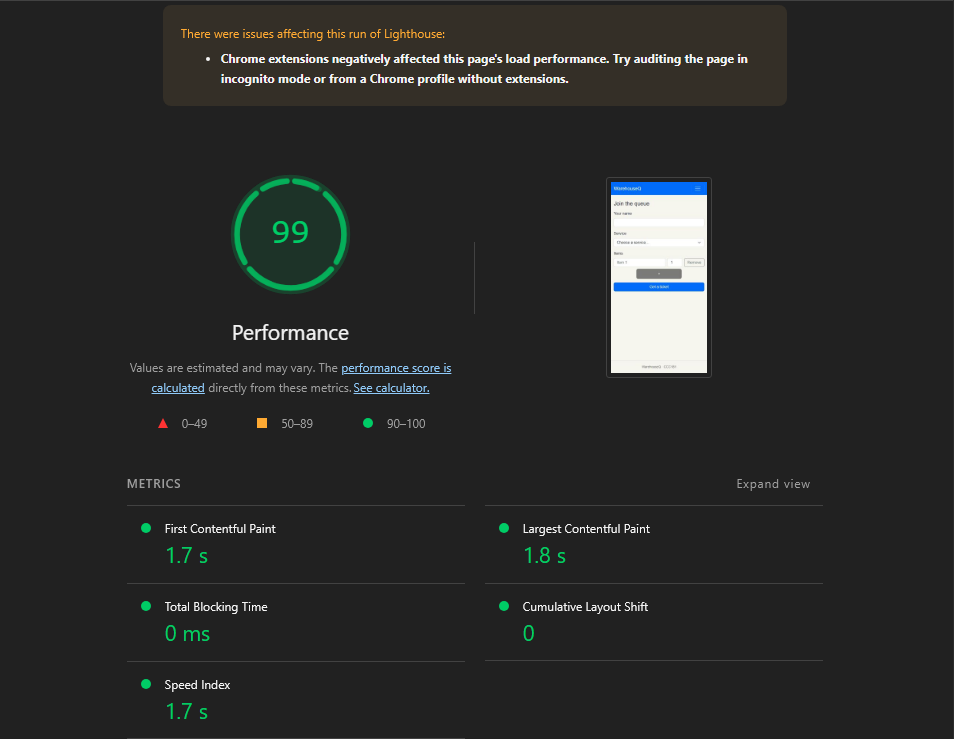

## Devtools:

### Lighthouse:

### Tab, Shift-Tab:
<video controls src="../../assets/tab-test.mp4" title="Keyboard navigation test"></video>

## Checklist:
| Check | Join | My place | Staff |
| --- | --- | --- | --- |
| Every input has a visible label |✅|✅|✅|
| Error messages say what to do, in text |✅|✅|✅|
| Status is shown in words, not only color |✅|✅|✅|
| Text and buttons are readable at 375 px with no sideways page scroll |✅|✅|✅|
| Buttons are at least about 44 × 44 px on a phone |✅|✅|✅|
| Page has one `<h1>` and headings in order |✅|✅|✅|
| `<html lang="en">` (or your language) is set |✅|✅|✅|