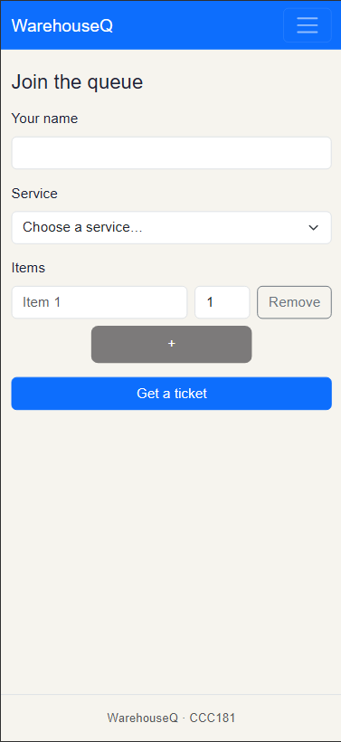
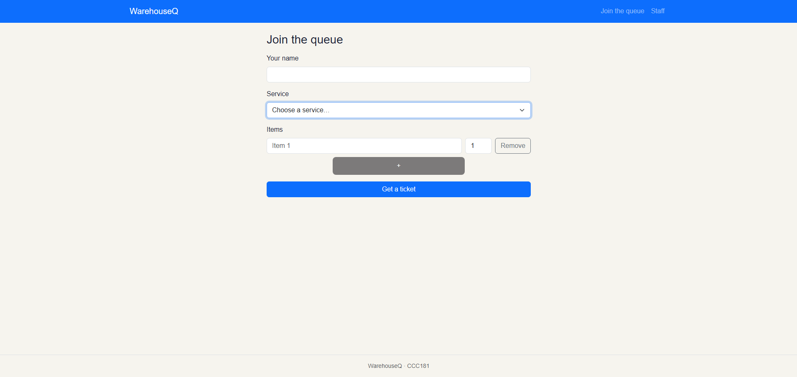
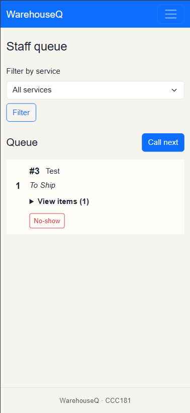
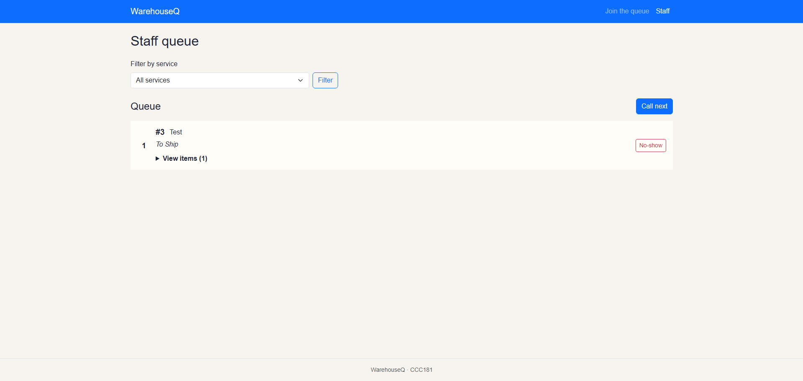

# Week 3 Report

## Title details

- **App:** WarehouseQ
- **Setting:** Warehouse queue for item checking and shipment processing
- **Full name:** Steve Nash H. Llamedo
- **Student ID:** 2024-1070
- **Section:** CS3A
- **Date:** October 24, 2026
- **Pull request:** "update later"

## Personas

- **Alex, the person waiting:** “I just hate standing around the loading bay not knowing if they've even started looking at my items yet. It delays my whole route.” Top tasks: join the right service queue, check ticket status and position, and know when to bring items to the desk.
- **Jade, the warehouse staff member:** “When five people walk up at once with different types of shipments, it's impossible to keep track of who got here first on paper.” Top tasks: view requests in order, identify each service, and call and update tickets.

See [Personas](personas.md).

## Screens

### Join on a phone

Alex uses this screen to join To Check or To Ship and list items; it covers REQ-C01.

### Join on a laptop

Alex uses this screen to join To Check or To Ship and list items; it covers REQ-C01.

### My place on a phone

Alex uses this screen to check the ticket status and people ahead and know when to go to the desk; it covers REQ-C02 and REQ-C03.

### My place on a laptop

Alex uses this screen to check the ticket status and people ahead and know when to go to the desk; it covers REQ-C02 and REQ-C03.

### Staff dashboard on a phone

Jade uses this screen to view requests in order, identify each service, and call, serve, or mark a no-show; it covers REQ-S01, REQ-S02, and REQ-S03.

### Staff dashboard on a laptop

Jade uses this screen to view requests in order, identify each service, and call, serve, or mark a no-show; it covers REQ-S01, REQ-S02, and REQ-S03.

## Design decisions

1. I kept **To Check** and **To Ship** as explicit service choices because Alex's persona and wireframe review identified confusion when the service was unclear. The selected service is also shown on the ticket.
2. I kept multiple item-name and quantity fields on the join form because warehouse staff need to see what is being checked or shipped. The staff dashboard lets Jade expand each ticket's item list.
3. I made the ticket status update automatically and kept the ticket number and queue position visible because Alex may wait away from the desk and could miss a verbal call in a noisy warehouse.

## Self-review

The wireframe review found that the Join screen did not clearly distinguish To Check from To Ship, My place did not give a useful instruction when the driver's turn arrived, and the staff dashboard did not make the next-ticket actions and queue order clear enough. The interface now offers both services, updates ticket status automatically, and gives staff controls to call the next ticket, mark it served, or mark it as a no-show. See [feedback.md](feedback.md).

## Accessibility

- **Lighthouse Accessibility scores:** Join: 99 / 100; My place: 99 / 100; Staff: 99 / 100.
- **Most important accessibility issue found and fixed:** Ticket Sizes.

## Usability test

| Task | Result | Approx. time | Hesitation or feedback |
| --- | --- | --- | --- |
| Join the queue for a service | Done with no help | 10 sec. | Hesitation on what items to add |
| Find ticket number and people ahead | Done with no help | 4 sec. | Automatically updates so just needs to stare at screen |
| Call next ticket and mark it served | Done with a bit of context| 13 secs | Easily navigated |

### Fixes
I changed how the ticket sizes looks on all screens.
 Also fixed how my root directory looked. I went and did my own style. sorry ma'am!

## Reflection

- **Hardest part this week:** Understanding the assignment. Alot of the context given does not match to the actual activities we had done. Also markdown is a pain to read in my editor since shifting to preview and write mode gets annoying sometimes..
- **When the data moves to a database in Week 4, I will change:** Expand more on my frontend and backend designs.. Its okay right now but could be improved.

## Declaration

I used an AI assistant to help explain documentations for the code regarding Flask and Jinja, what the homework is trying to say due to vague aspects, and to help me draft the planning of the app's identity