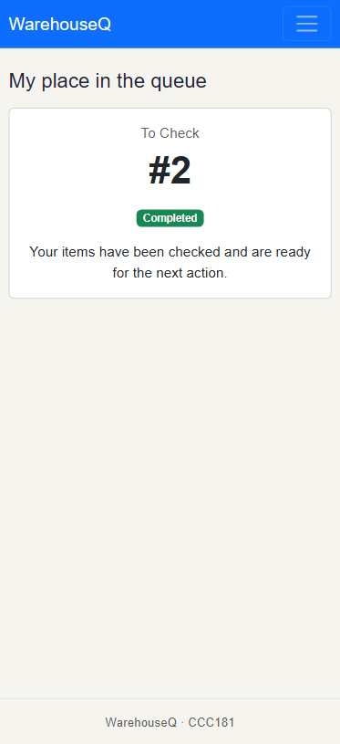
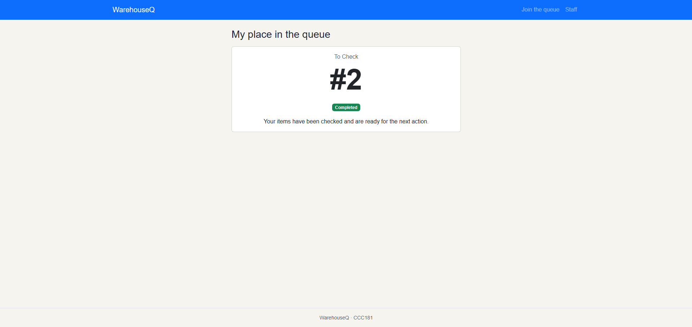
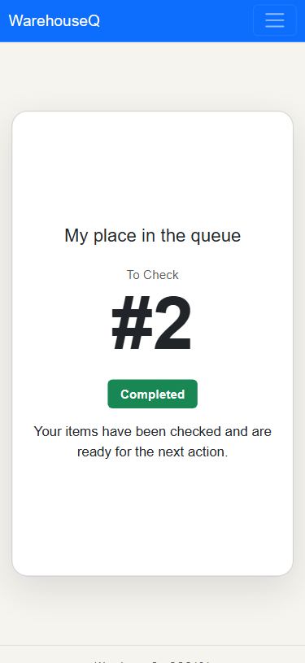
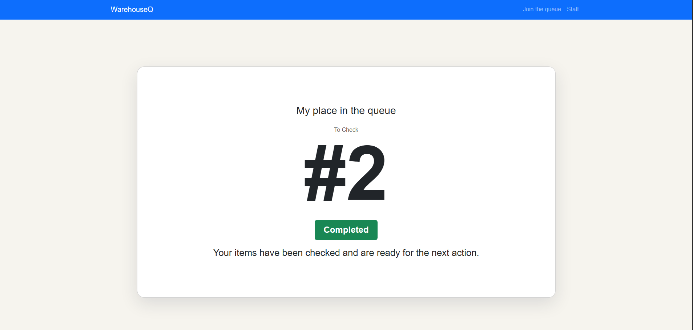

## User:  Stephen Nathan H. Llamedo

1. "You just arrived. Get in line for **Check In**."
    - Easily checked in.
2. "How many people are ahead of you? What is your number?"
    - 3, my number is #4
3. "Pretend you are the staff member. Call the next person and mark them as served."
    - The buttons needed stands out and easy to use.

---
- Did they finish it? (yes / with help / no)
    - Yes.
- About how long it took
    - 3 mins.
- Where they hesitated, what they said, and anything that surprised you
    - "Why can i access staff in home?"
- Which of your persona's *"Because …, my interface must …"* rules held up, and which did not
    - Alex's rules mostly held up: the participant joined the queue easily, found their ticket number and position, and said the staff action buttons were easy to use. The live ticket information supported Alex's need to check their place without asking staff. One issue surfaced: they asked, "Why can I access staff in home?" This suggests the interface should make the staff area clearly staff-only or separate it from the customer navigation.

## Issue
The way how tickets arent really that big and centered unlike the framework was an issue in one of the persona's problem. This was fixed by seperating tickets to a new css class and made them big and adjust to screen size:

Before:  

After:  

