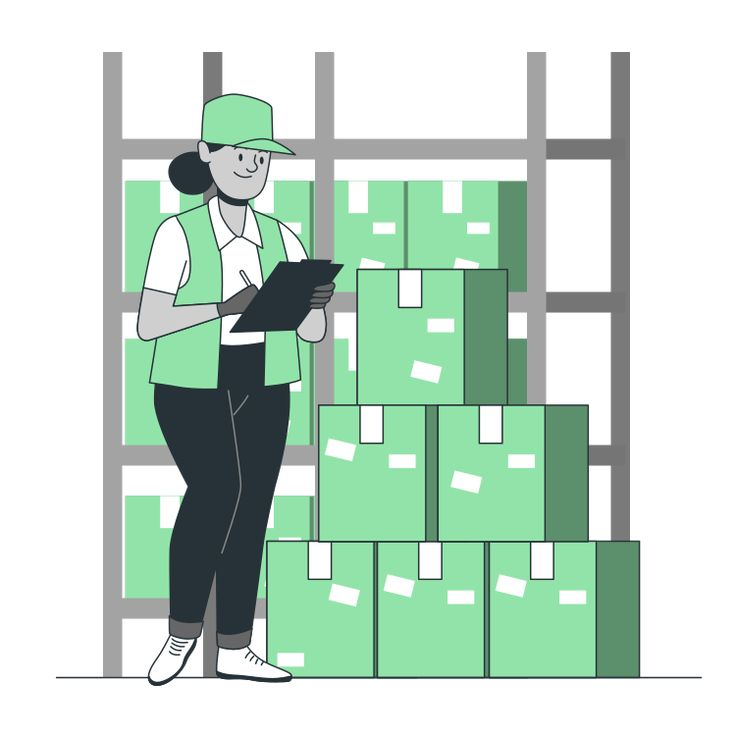

# WarehouseQ Personas

## Alex, the person waiting

> "I just hate standing around the loading bay not knowing if they've even started looking at my items yet. It delays my whole route."

| | |
| --- | --- |
| **Photo or sketch** |  |
| **Age, role and background** | 34, Logistics Coordinator/Driver for a mid-sized retail supplier. Handles daily drop-offs and pickups. |
| **Goals** | - Get items checked or prepared for shipment  - Know when the items are ready for the next step  - Avoid losing time waiting without an update. |
| **Frustrations** | 1. Not knowing the estimated wait time, trapping them at the facility. 2. Missing their turn because the warehouse floor is too loud to hear verbal call-outs. 3. Confusion over whether to queue in the "Check" or "Ship" lane upon arrival. |
| **Devices and context** | Smartphone (iOS or Android). They are usually waiting in a noisy loading bay, the driver lounge, or their truck cab while checking other route schedules. |
| **Tech comfort** | [High] Uses GPS routing, dispatch software, and inventory tracking apps daily. |
| **Accessibility needs** | Requires strong haptic/vibration notifications because warehouse noise makes audio alerts unreliable. |

### Scenario

Alex brings a batch of items to the warehouse for checking before they can be shipped. Alex joins the queue and selects the service that matches the items. While warehouse staff process earlier requests, Alex checks the ticket to see its status and place in line. When the request is called, Alex brings the items to the desk so staff can complete the check and move them toward shipping.

### Top tasks in the app

| Task | Screen | Requirement ID |
| --- | --- | --- |
| Join the queue to have items checked or shipped | Join | REQ-C01 |
| Check ticket status and position in line | My place | REQ-C02 |
| Know when it is time to bring the items to the desk | My place | REQ-C03 |

### What this means for my interface

1. Because Alex needs to know what is happening to the items, my interface must let the ticket show the selected service and current status clearly.
2. Because Alex may be waiting away from the desk, my interface must let the ticket number and position in line must be easy to find on a phone.
3. Because the queue involves different item services, my interface must let the join form make "To Check" and "To Ship" easy to distinguish.

---

## Jade, the warehouse staff member

> "When five people walk up at once with different types of shipments, it's impossible to keep track of who got here first on paper."

| | |
| --- | --- |
| **Photo or sketch** |  |
| **Age, role and background** | 28, Warehouse Receiving Specialist. 4 years of inventory processing experience. |
| **Goals** | - Process items in the right order - Identify whether a request is for checking or shipping - Keep ticket statuses accurate as work is completed. |
| **Frustrations** | 1. Illegible handwriting on physical queue slips causing processing delays. 2. Customers constantly approaching the desk out of turn to ask for status updates, interrupting workflow. 3. Accidentally mixing up "To Check" and "To Ship" priorities during rush hours. |
| **Devices and context** | Company-issued rugged tablet and a barcode scanner mounted at the receiving desk. They are multitasking between moving boxes and tapping the screen. |
| **Tech comfort** | [Medium] Comfortable with standard warehouse management systems, but easily frustrated by software with too many sub-menus or small buttons. |
| **Accessibility needs** | Needs high-contrast text and large touch targets due to poor overhead lighting at the dock and wearing work gloves. |

### Scenario

Jade is working at the warehouse desk while requests for item checks and shipments arrive. Jade opens the staff dashboard to see the waiting requests in order, checks the service for the next ticket, and calls the person when ready to handle their items. After completing a step, Jade updates the ticket so the queue reflects what has actually happened.

### Top tasks in the app

| Task | Screen | Requirement ID |
| --- | --- | --- |
| View waiting requests in order | Staff dashboard | REQ-S01 |
| Identify whether the next request is to be checked or shipped | Staff dashboard | REQ-S02 |
| Call a person and update their ticket after processing | Staff dashboard | REQ-S03 |

### What this means for my interface

1. Because Jade handles more than one type of request, my interface must let each queue entry must make its service easy to identify.
2. Because Jade needs to work through requests in order, my interface must let the dashboard make the next waiting ticket obvious.
3. Because ticket status should match the item's actual progress, my interface must let staff actions must be clear and the updated status must be visible.